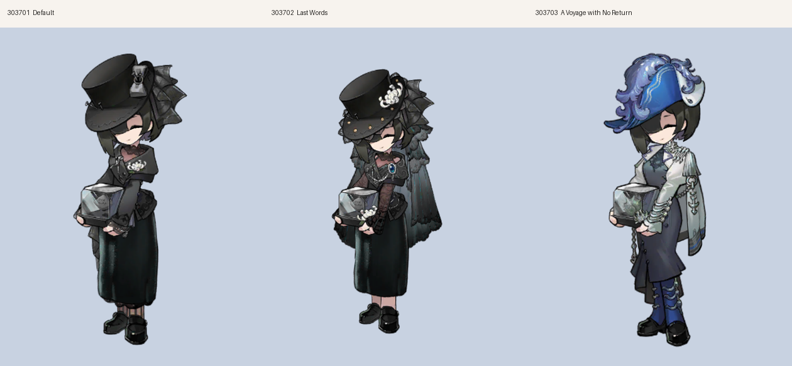

# NecrologistMascot

一只住在桌面上的《重返未来：1999》**讣告人（Necrologist）** Q 版桌宠。透明无边框、始终置顶、随手拖动；单击会动，也能绑全局按键。



| | |
|---|---|
| **技术栈** | .NET 10 · Avalonia 11.3 · spine-csharp 4.2 · SkiaSharp · SharpHook |
| **平台** | Windows（完整功能）· macOS / Linux 可运行（窗口特效、开机自启、单实例唤醒仅 Windows 生效）|

---

## 下载

到 [Releases](https://github.com/HBrOcean/NecrologistMascot/releases) 下载 `NecrologistMascot-win-x64.zip`，解压后双击 `NecrologistMascot.exe`。

自包含单文件，**不需要另装 .NET 运行时**。首次启动贴在主屏右下角。

## 特性

**界面与配置**

- 皮肤**自动扫描** `Assets/characters`，没有硬编码列表；新增目录即新增皮肤
- 皮肤选择是独立的**卡片网格页签**，每张卡片带实时渲染的缩略图
- 皮肤显示名**三级兜底**：`config.json` 里的 `SkinNames` → 目录内 `display.txt` → 目录名
- 资源不全的皮肤**置灰不可选**（仍显示，方便看出缺了什么）
- 按键绑定**可视化编辑**：每条绑定是一张两行卡片，动作从下拉里挑、已选动作是 chip 标签，格式非法标红，可一键恢复默认
- **托盘菜单与右键菜单**都能直接切皮肤、播动作、重置位置、隐藏、退出
- **单实例**：再次启动不会开出第二只，而是唤醒已经在跑的那一只

**动作逻辑**

- 单击播放动作，播完自动回待机
- 定时随机动作默认 **20 秒**一次，可关，间隔 **5~180 秒**可调
- 任何一次手动动作（点击 / 快捷键 / 托盘）都会**重置定时器**，不会刚点完又被催
- 随机池排除 `idle / born / sleep / die / posture` 这类状态型动画
- 连续两次不会抽到同一个
- **定时随机与「点击动作」彻底解耦**：点击按你配置的动作播，定时器则完全忽略该配置走纯随机

**渲染与窗口几何**

- 30fps 实时渲染 Spine 动画，贴图按 **RGBA8888 / Premul** 解码，alpha 通道完整（透明区不会出白块）
- 包围盒**逐帧 49 帧采样 + 分位数保护**，个别动画把骨架位移到很远也不会把框撑大
- 绘制比例**只由「缩放 × DPI」决定**，与窗口尺寸解耦（不会出现"窗口变大→角色变小"的反馈环）
- 窗口尺寸**三档可选**（设置 → 桌宠 → 窗口尺寸）：
  - **绝对框**（默认）：把窗口一次定到能装下所有帧，包括「角色飞出画面」的大招帧——**一帧都不裁**，尺寸恒定不变
  - **动作范围**：踢掉骨架整体位移的帧后取并集，窗口小一圈，但 skill3 这类飞出画面的动作会被裁在窗外
  - **随动作伸缩**：窗口最小，播动作时临时变大、1 秒后缩回
- 固定框模式下锚点按「框的实际不对称度」落位，不再硬钉正中——讣告人的大招把角色甩到画面左侧，
  硬居中会让窗口白宽 30%（626 → 439 px @60%），这样既不浪费也不裁
- resize 一律**锚定角色脚底在屏幕上的位置**，缩放/换皮肤时脚原地不动，底边不漂
- 固定框模式**完全不做每帧尺寸轮询**：窗口尺寸是常量，没有 33ms 的比较与 resize
- 视框收缩是「延迟 1 秒 → 一次到位」，不是逐帧插值——后者会让窗口以 2px 一步的频率跟，看起来一格一格地抖
- 角色锚点取「头部带 x 中位数 + 待机顶点 y 的 2% 分位」，几套皮肤换着切也不会上下左右跳
- 允许把窗口**拖到屏幕外**，贴边不回弹（吸附默认关闭）
- 换肤不播 `born`——那是「从画面外飞入」的入场动画，只在冷启动播

---

## 皮肤

启动时扫描 `Assets/characters/` 下每个子目录：凑齐同名的 `.atlas` 和 `.skel` 就算一套可用皮肤。

内置三套（UTTU 素材，已随包提供）：

| ID | 名称 | 备注 |
|---|---|---|
| `303701` | 讣告人 · 默认 | 默认皮肤 |
| `303702` | 讣告人 · 最后的诉说 | 洞悉二 |
| `303703` | 讣告人 · 永不返航 | 「不沉的」系列 |

### 显示名的优先顺序

1. `config.json` 里的 `SkinNames`（例如 `"SkinNames": { "303701": "我的讣告人" }`）
2. 皮肤目录里的 `display.txt`（UTF-8，第一行生效）
3. 目录名本身

### 加一套自己的皮肤

1. 在 `Assets/characters/` 下新建子目录，**目录名就是皮肤 ID**
2. 放进同名文件：`<ID>.atlas`、`<ID>.skel`，以及 atlas 里声明的图集（PNG，保留 alpha）
3. 想改显示名就加一个 `display.txt`
4. 打开 设置 → **皮肤** → 「刷新列表」

> ⚠ **不要重新打包图集**。Spine 的 mesh UV 是烘焙进 `.skel` 的整页归一化坐标，区域一旦挪位，mesh 会碎成一片。

---

## 默认快捷键

全部是 `Ctrl + 键`，可在 设置 → **按键** 里改，支持 `Ctrl+Shift+A` 这类多修饰组合。

| 快捷键 | 动作 | 快捷键 | 动作 |
|---|---|---|---|
| `Ctrl + Y` | 打开设置 | `Ctrl + G` | giddy |
| `Ctrl + N` | 关闭设置 | `Ctrl + H` | hit |
| `Ctrl + 1` | skill1 | `Ctrl + I` | idle |
| `Ctrl + 2` | skill2 | `Ctrl + P` | posture |
| `Ctrl + D` | die | `Ctrl + S` | sleep |
| `Ctrl + Q` | unique | `Ctrl + B` | born |

> 全局钩子只监听、不拦截。所以在编辑器里按 `Ctrl+S` 会同时触发编辑器自己的保存——介意的话改成 `Ctrl+Shift+字母`。

---

## 配置与日志

- Windows：`%AppData%\NecrologistMascot\config.json`
- macOS / Linux：`~/.config/NecrologistMascot/config.json`
- 日志同目录下的 `log.txt`，排查问题先看它
- 皮肤缩略图缓存：同目录 `thumbs/`（换模型后对不上，点设置里的「重建预览图」）

所有选项都能在设置面板改，一般不用手写 JSON。

---

## 从源码构建

需要 [.NET 10 SDK](https://dotnet.microsoft.com/download)。

```bash
# Windows
build.bat

# macOS / Linux
chmod +x build.sh && ./build.sh

# 或者
dotnet run
```

打包自包含单文件：

```bash
dotnet publish -c Release -r win-x64 -p:PublishSingleFile=true --self-contained true
```

推送到 GitHub 后 Actions 自动在 `windows-latest` 上构建；打 `v*` 标签会自动发 Release：

```bash
git tag v0.1.0
git push origin v0.1.0
```

### 自带诊断开关

不开窗口，直接验证素材与几何（排查"角色被裁/位置怪"时很有用）：

```bash
# 每套皮肤渲一张图到临时目录（<tmp>/NecrologistMascot-dump/）
NecrologistMascot.exe --dump
NecrologistMascot.exe --dump 303701

# 纯数值核对：逐动画逐帧算「会不会画到窗口外」
#   --fit [缩放] [皮肤id|-] [motion|absolute|dynamic]
NecrologistMascot.exe --fit                        # 默认 15% 缩放 + 绝对框
NecrologistMascot.exe --fit 0.8 303702 absolute
NecrologistMascot.exe --fit 0.6 - motion           # 看「动作范围」模式会裁哪些帧

# 窗口预演：画布尺寸 = 真实窗口尺寸，直观看角色占多大、会不会出界
#   --preview [皮肤id|-] [缩放] [模式]
NecrologistMascot.exe --preview 303701 0.6 absolute
```

`--fit` 输出形如 `横向最坏 80%（die） 向上最坏 89%（innate）`，`≤100%` 即全部在窗口内。

---

## 常见问题

**桌宠不见了**

`Ctrl + Y` 打开设置，或点托盘图标选「显示 / 隐藏桌宠」。如果是被拖到屏幕外，用托盘菜单的「重置位置」——这是唯一始终点得到的入口（托盘图标固定在任务栏）。

**快捷键没反应**

看 `log.txt` 里有没有 `[Key] 匹配 ...`。没有记录说明按键被系统或别的软件拦了；有记录但不触发，检查格式是不是 `修饰键 + Vc键名`（如 `Ctrl+Vc1`），设置面板里格式错了会标红。

**换了皮肤，部分快捷键不动了**

不同角色的动画名不通用。绑定里失效的动作名会变红，删掉重选即可。

**开了鼠标穿透后拖不动**

穿透模式下点击落到下层窗口，角色本身收不到事件。从托盘菜单关掉。

**窗口比角色大很多 / 角色显得小**

默认的「绝对框」模式为了做到「一帧都不裁」，把大招里角色飞出画面的距离也算进了窗口（1012 单位宽，角色本体只有 249）。窗口是透明的，看不见边界，但它**会拦截鼠标点击**。觉得碍事的话：

- 设置 → 桌宠 → 窗口尺寸 → 换成「动作范围」（窗口小一圈，代价是 skill3 会被裁）
- 或者把「缩放」调大，角色和窗口一起变大
- 或者开「鼠标穿透」，点击直接落到下层窗口

**窗口尺寸在播动作时变来变去**

那是「随动作伸缩」模式。想让它固定，换成「绝对框」或「动作范围」。

**角色/窗口在抖**

先确认不是「上下浮动」开着。仍然抖的话，用 `NECRO_TRACE=1` 启动，看 `log.txt` 里的 `[Trace]` 行：

- `pw/ph/ratio/ground` 全都不变 → 抖动不在渲染层，检查是不是有别的程序在改窗口位置
- 这些值在周期性变化 → 说明窗口正在被反复 resize，把日志发我

三个已知的抖动源都已修掉：启动/换肤时视框从默认框收敛（会连续 resize 二三十次）、动态模式收缩逐帧插值、`OnSizeTick` 每 33ms 无谓轮询。

---

## 平台限制

| 功能 | Windows | macOS / Linux |
|---|---|---|
| 透明置顶窗 / 拖动 / 缩放 | ✅ | ✅ |
| 全局快捷键（SharpHook） | ✅ | ✅ |
| 鼠标穿透、置底 | ✅ | ❌ 记录日志后忽略 |
| 开机自启 | ✅ | ❌ |
| 单实例唤醒 | ✅ | ⚠ 命名事件在 .NET 的非 Windows 实现里不支持，第二实例会静默退出 |

**不能在 Termux / Android 上跑**：Avalonia 需要桌面图形栈、SkiaSharp 没有 `android-arm64` RID、SharpHook 依赖 libuiohook。Termux 只适合当推送工具。

---

## 许可

代码为 MIT（见 [LICENSE](LICENSE)）。

`Assets/` 下的角色素材**不在 MIT 范围内**，版权归原权利方所有，仅供个人非商业使用：

- 角色素材来自 UTTU 存档（《重返未来：1999》，讣告人 303701 / 303702 / 303703）
- Spine 运行时来自 [esotericsoftware/spine-runtimes](https://github.com/esotericsoftware/spine-runtimes)（spine-csharp 4.2），遵循 Spine Runtime License
